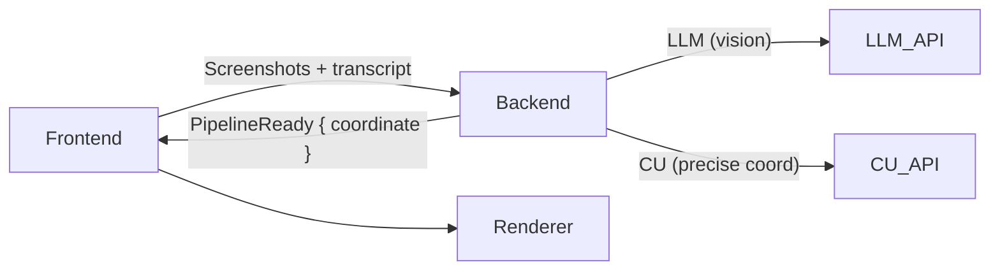
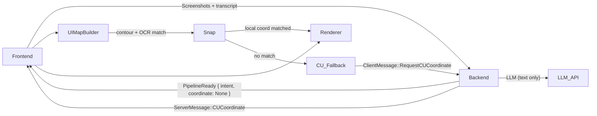
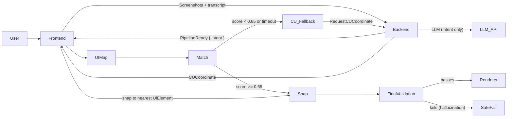

# Hybrid UI-Map Coordinate Detection Plan

## Current Architecture




## Target Architecture




---

## New Shared Type (`clicky-types/src/lib.rs`)

Add one new struct and two new message variants. No existing types are removed.

```rust
// New struct
pub struct ElementIntent {
    pub label: String,                 // human-readable: "Submit button", "Search field"
    pub action: String,                // "click", "focus", "hover"
    pub region_hint: Option<String>,   // "top right", "center", "bottom left"
    pub screen_number: Option<u32>,
}

// Add to ClientMessage enum
ClientMessage::RequestCUCoordinate {
    intent: ElementIntent,
    screenshot_index: usize,    // which ScreenshotData to use for CU
}

// Add to ServerMessage enum
ServerMessage::CUCoordinate {
    coordinate: Option<(f64, f64)>,
}
```

`PipelineReady` keeps its current shape. The `coordinate` field becomes permanently `None` for the primary path. `display_infos` is still sent (needed for UI-map coordinate mapping).

---

## Step-by-Step Execution

### Step 1 — `clicky-types/src/lib.rs`

- Add `ElementIntent` struct (serde Serialize + Deserialize, Clone, Debug) — fields: `label`, `action`, `region_hint: Option<String>`, `screen_number: Option<u32>`.
- Add `ClientMessage::RequestCUCoordinate { intent: ElementIntent, screenshot_index: usize }`.
- Add `ServerMessage::CUCoordinate { coordinate: Option<(f64, f64)> }`.
- **No breaking changes** — all existing variants are untouched; serde uses tagged enums so old messages still parse.

### Step 2 — `backend/src/handlers/llm_pipeline.rs`

Change the LLM prompt to request structured intent instead of a POINT tag.

- In `run_llm_pipeline`, replace the POINT-tag prompt instruction with:
  > "Respond with a JSON block: `{\"label\":\"...\",\"action\":\"click\",\"region_hint\":\"top right / center / bottom left\"}`. Do not guess coordinates. If no UI element is relevant, omit the block."
- After the LLM response, parse the intent JSON (a new private `parse_intent_json(text: &str) -> Option<ElementIntent>`) instead of calling `point_parser::parse_claude_response`.
- Remove the CU parallel call from the primary pipeline — CU is now triggered on-demand from the frontend.
- Change `PipelineReady` to always emit `coordinate: None`; add `intent: Option<ElementIntent>` to `ServerMessage::PipelineReady`.

**Affected functions:**

```rust
// backend/src/handlers/llm_pipeline.rs
fn parse_intent_json(text: &str) -> Option<ElementIntent>
// replaces: point_parser::parse_claude_response + detect_computer_use_coordinate
```

### Step 3 — `backend/src/server.rs`

Handle the new `ClientMessage::RequestCUCoordinate` in `handle_client_message`:

```rust
ClientMessage::RequestCUCoordinate { intent, screenshot_index } => {
    // look up pending_screenshots (still stored from the last Screenshots message)
    // spawn: computer_use::detect_element_location(...)
    // send: ServerMessage::CUCoordinate { coordinate }
}
```

The `pending_screenshots` are already held in the connection state. No new storage needed.

### Step 4 — `src/audio/mod.rs` (`UiEvent` enum)

Add two new variants. No existing variants change:

```rust
UiEvent::PipelineReadyWithIntent {
    spoken_text: String,
    mp3_bytes: Vec<u8>,
    intent: Option<ElementIntent>,
    display_infos: Vec<DisplayInfo>,
},
UiEvent::CUCoordinateReady {
    coordinate: Option<(f64, f64)>,
},
```

Keep `UiEvent::PipelineReady` as a type alias or leave it in place for the zero-intent path (i.e., when `intent` is `None`, fall through to existing Responding behavior with no flight animation).

### Step 5 — New module: `src/ui_map/mod.rs`

This is the core new module. It operates entirely on the JPEG bytes already captured by the frontend — no new screenshot is needed.

```rust
// src/ui_map/mod.rs

pub struct UiElement {
    pub label: Option<String>,       // from OCR or heuristic
    pub center_x: f64,               // in screenshot pixels
    pub center_y: f64,
    pub width: f64,
    pub height: f64,
}

pub struct UiMap {
    pub elements: Vec<UiElement>,
    pub screenshot_width: u32,
    pub screenshot_height: u32,
    /// Binary edge mask produced by the Sobel step — retained so the safety
    /// validation gate can call `no_edge_pixels_nearby` without re-running
    /// edge detection.  Each pixel is 0 (no edge) or 255 (edge).
    /// Requires `use image::GrayImage;` at the top of the module.
    pub edge_mask: GrayImage,
}

/// Result of a single match attempt — carries the element AND its score
/// so the caller can apply the confidence gate.
pub struct MatchResult {
    pub element: UiElement,
    pub score: f32,
}

/// Entry point: build a UiMap from raw JPEG bytes.
/// Uses contour detection (luminance + edge scan) to find rectangular blobs.
/// Does NOT require any external crate beyond `image` (already present, needs png feature added).
pub fn build_ui_map(jpeg_bytes: &[u8]) -> Result<UiMap, UiMapError>

/// Match an intent against the elements in the map.
/// Returns a MatchResult with score, or None if no element clears the
/// confidence threshold (MATCH_CONFIDENCE_THRESHOLD = 0.65).
pub fn match_intent(map: &UiMap, intent: &ElementIntent, cursor_pos: Option<(f64, f64)>) -> Option<MatchResult>
```

**Implementation strategy for `build_ui_map` (no new crates required):**

The `image` crate (already in `Cargo.toml`) can decode JPEG and provide pixel access. We need to add the `png` feature for internal intermediate processing, or keep working in `RgbaImage`. The algorithm:

1. Decode JPEG → `RgbaImage` (via `image::load_from_memory`).
2. Convert to grayscale → `GrayImage` (via `image::imageops::grayscale`).
3. Apply a 3×3 box blur (`image::imageops::blur`) before edge detection to reduce JPEG block-artefact noise.
4. Simple Sobel edge kernel (3×3, implemented inline — no `imageproc` needed): produces edge magnitude image.
5. Threshold at a tunable value (e.g., `EDGE_THRESHOLD: u8 = 30`) → binary edge mask.
6. Connected-component labeling with a union-find (implement a small `UnionFind` struct inline — ~40 lines): group adjacent edge pixels into blobs.
7. Bounding box each blob; apply the following filters:
   - **Minimum area:** discard if `bbox.area() < 300` (raised from 200 — filters thin lines and noise better).
   - **Maximum area:** discard if `bbox.area() > 200_000` (full-screen overlays).
   - **Aspect ratio:** prefer `0.5 ≤ width/height ≤ 3.0`; discard blobs outside this range as they are likely rule lines or decorations, not interactive elements.
8. Each surviving blob becomes a `UiElement` with `center_x/center_y` at its bounding-box center.
9. OCR is deferred (see Risk section) — labels stay `None` for now; matching falls back to geometric scoring.

**`match_intent` scoring and confidence gate:**

```rust
const MATCH_CONFIDENCE_THRESHOLD: f32 = 0.65;

// Per-element score (all terms normalised 0.0–1.0 before weighting)
score =
  text_similarity        // Jaro-Winkler vs intent.label (0.0 when OCR absent)
+ region_hint_match      // +0.30 bonus if element center is in the hinted screen region
+ size_weight            // prefer 24–80 px height (typical button range)
+ position_bias          // proximity to viewport action zone (vertical centre ± 30%)
+ cursor_proximity_bias  // +0.20 bonus for element nearest to current cursor position

// Mandatory gate — anything below threshold triggers CU fallback
if best_score < MATCH_CONFIDENCE_THRESHOLD {
    return None;
}
```

**Cursor proximity bias:** `match_intent` receives `cursor_pos: Option<(f64, f64)>` (screenshot-space pixels). When `Some`, add a `0.20` bonus to the element whose center is closest to the cursor. This rewards the natural user tendency to speak about something near where they are looking. When `None`, the bonus is 0 for all elements.

### Step 6 — `src/overlay/window.rs`

- Add `pending_intent: Option<ElementIntent>` and `last_screenshots: Option<Vec<ScreenshotData>>` fields to `OverlayApp`.
- In `handle_hotkey(Released)`: save `capture_all_screens()` result into `self.last_screenshots` (it is already sent to the backend — we now also keep a local copy). Also record `cursor_pos_at_release` for use as the cursor proximity hint.
- In `handle_ui_event(PipelineReadyWithIntent)`:
  - Transition to `Responding`.
  - Play TTS.
  - If `intent` is `Some`: use `tokio::select!` to race UI-map matching against a 120 ms CU-trigger timeout:

```rust
tokio::select! {
    // Branch A — local UI-map match
    result = spawn_blocking(|| {
    let map = ui_map::build_ui_map(&jpeg_bytes).ok()?;
    ui_map::match_intent(&map, &intent, Some(cursor_pos))
}) => {
        match result {
            Some(MatchResult { element, score }) if score >= MATCH_CONFIDENCE_THRESHOLD => {
                // snap coordinate is element.center mapped to global display space
                render_state.start_flight_to(mapped_x, mapped_y, spoken_text);
            }
            _ => {
                // score too low or no element — fall through to CU
                send ClientMessage::RequestCUCoordinate { intent, screenshot_index };
                self.cu_coordinate_pending = true;
            }
        }
    }
    // Branch B — 120 ms deadline; CU fires in parallel if UI map hasn't resolved
    _ = tokio::time::sleep(Duration::from_millis(120)) => {
        send ClientMessage::RequestCUCoordinate { intent, screenshot_index };
        self.cu_coordinate_pending = true;
        // Branch A result is discarded if it arrives after CU already fired
    }
}
```

- In `handle_ui_event(CUCoordinateReady)`:
  - **Snap to nearest UiElement first** (mandatory — never act on raw CU output):
    ```rust
    let snapped = snap_to_nearest_ui_element(cu_coord, &self.last_ui_map);
    // reject if no UI element within radius=40 px → safe fail
    ```
  - Apply drift compensation using a freshly sampled cursor position (not the stale `mouse_pos_at_release`).
  - Call `render_state.start_flight_to(snapped_x, snapped_y, ...)`.
  - Apply final safety validation (screen-centre guard + edge proximity check) before `start_flight_to`.

**Coordinate mapping from screenshot pixels to global display space (explicit rule):**

```
1. Identify the display: look up display_infos[screenshot_index].
2. Normalize the element center to [0.0, 1.0] within that display's screenshot:
     norm_x = element.center_x / screenshot_width
     norm_y = element.center_y / screenshot_height
3. Scale to that display's logical size:
     local_x = norm_x * display_info.width
     local_y = norm_y * display_info.height
4. Add the display's global offset to get the final global coordinate:
     global_x = display_info.x + local_x
     global_y = display_info.y + local_y
```

This logic is inlined into `handle_ui_event` (~10 lines) — no separate mapper module needed.

### Step 7 — `src/api/adapter.rs`

- Extend `server_message_to_ui_event` to handle `ServerMessage::CUCoordinate` → `UiEvent::CUCoordinateReady`.
- Extend to handle updated `ServerMessage::PipelineReady` (now with `intent` field) → `UiEvent::PipelineReadyWithIntent`.

---

## File-by-File Change List


| File                                   | Type    | Change                                                                                            |
| -------------------------------------- | ------- | ------------------------------------------------------------------------------------------------- |
| `clicky-types/src/lib.rs`              | Modify  | Add `ElementIntent`, `RequestCUCoordinate`, `CUCoordinate`, add `intent` field to `PipelineReady` |
| `backend/src/handlers/llm_pipeline.rs` | Modify  | Replace POINT-tag + parallel CU with intent JSON parse; emit `coordinate: None`                   |
| `backend/src/server.rs`                | Modify  | Handle `ClientMessage::RequestCUCoordinate`, spawn on-demand CU                                   |
| `src/audio/mod.rs`                     | Modify  | Add `UiEvent::PipelineReadyWithIntent`, `UiEvent::CUCoordinateReady`                              |
| `src/ui_map/mod.rs`                    | **New** | `build_ui_map`, `match_intent`, `UiElement`, `UiMap`, inline Sobel + union-find                   |
| `src/overlay/window.rs`                | Modify  | Save screenshots locally, handle new events, call ui_map, trigger CU fallback                     |
| `src/api/adapter.rs`                   | Modify  | Map new `ServerMessage` variants to `UiEvent`                                                     |
| `src/main.rs`                          | Minor   | Add `pub mod ui_map`                                                                              |
| `Cargo.toml` (root)                    | Minor   | Add `png` feature to `image` dep if needed for intermediate decode                                |


---

## Exact Function Signatures

```rust
// clicky-types/src/lib.rs (additions)
pub struct ElementIntent {
    pub label: String,
    pub action: String,
    pub region_hint: Option<String>,   // "top right", "center", "bottom left"
    pub screen_number: Option<u32>,
}

// src/ui_map/mod.rs (new file)
pub struct MatchResult { pub element: UiElement, pub score: f32 }
pub fn build_ui_map(jpeg_bytes: &[u8]) -> Result<UiMap, UiMapError>;
pub fn match_intent(map: &UiMap, intent: &ElementIntent, cursor_pos: Option<(f64, f64)>) -> Option<MatchResult>;
pub fn snap_to_nearest_ui_element(coord: (f64, f64), map: &UiMap, radius: f64) -> Option<(f64, f64)>;
// Selection rule:
//   1. Candidates = elements whose center is within `radius` px of `coord`.
//   2. If no candidates → return None (safe fail).
//   3. If one candidate → return its center.
//   4. If multiple → pick the element with the highest  area * proximity_score,
//        where proximity_score = 1.0 - (distance / radius)  (closer = higher).
//      This prefers large, nearby elements over small ones at the edge of the radius.
struct UnionFind { parent: Vec<usize> }  // private
fn sobel_edge_magnitude(gray: &image::GrayImage) -> image::GrayImage;  // private
fn connected_components(edges: &image::GrayImage, threshold: u8) -> Vec<BoundingBox>;  // private

// backend/src/handlers/llm_pipeline.rs (new private)
fn parse_intent_json(text: &str) -> Option<ElementIntent>;

// backend/src/server.rs (extended match arm — not a new function)
// handle_client_message extended with RequestCUCoordinate arm
```

---

## Execution Order

1. **Step 1** — Update `clicky-types` (unblocks all other steps).
2. **Step 2** — Update backend LLM pipeline (backend compiles standalone).
3. **Step 3** — Update backend server (CU on-demand).
4. **Step 4** — Update `UiEvent` in frontend.
5. **Step 5** — Create `src/ui_map/mod.rs`.
6. **Step 6** — Update `src/overlay/window.rs`.
7. **Step 7** — Update `src/api/adapter.rs`.
8. **Verify** — `cargo build` (workspace).

---

## Risk Areas

- **OCR accuracy:** Without an OCR crate, `match_intent` has no text-signal in Phase 1. The first implementation will be geometry-only (nearest centroid to the viewport action zone). This is conservative: most mismatches will fall through to CU fallback, which is correct behavior. OCR via `leptess` (Tesseract bindings) can be layered in a follow-up step without changing any interfaces.
- **Contour quality on compressed JPEGs:** JPEG at quality 80 with 1280px max introduces block artefacts that inflate the Sobel edge response. Mitigation: raise the `EDGE_THRESHOLD` constant and apply a 3×3 box blur (implementable inline with `image::imageops::blur`) before edge detection.
- `**image` crate JPEG decode feature:** The root `Cargo.toml` specifies `features = ["jpeg"]` only. `image::load_from_memory` for JPEG needs only the `jpeg` feature, so no Cargo change is needed for `build_ui_map`.
- `**pending_screenshots` lifetime in backend:** The backend currently drops `pending_screenshots` after the LLM pipeline fires. `RequestCUCoordinate` arrives later, so the server state must retain the screenshots. The simplest fix: replace `pending_screenshots: Option<...>` with `last_screenshots: Option<...>` and only overwrite it on new captures, never clear it after pipeline.
- **Drift compensation timing:** The CU fallback round-trip adds ~1–3 s latency. The cursor may have moved significantly. The drift compensation logic (currently in `handle_ui_event(PipelineReady)`) must be applied at `CUCoordinateReady` time using a freshly sampled cursor position, not the stale `mouse_pos_at_release` snapshot.
- **Screen-number routing for CU fallback:** `RequestCUCoordinate` must include `screenshot_index` so the backend uses the correct display's screenshot. The frontend knows which display index corresponds to `is_cursor_display` from the `display_infos` returned in `PipelineReadyWithIntent`.

---

## Final Production Specification (Addendum)

### Core Philosophy

```
LLM = WHAT (intent only)
UI MAP = WHERE (deterministic)
SYSTEM = VERIFY (confidence gate)
```

The system **NEVER** trusts the LLM for coordinates. Every coordinate must originate from a real UI element in the map or from a CU pass that is then snapped to the nearest UI element.

---

### Core Rules (Strict)

1. LLM MUST NEVER output coordinates.
2. All coordinates MUST come from UI elements.
3. Every coordinate MUST be validated or snapped.
4. If confidence is low → fallback immediately.
5. Never act on raw model output.

---

### Extended Types

The `ElementIntent` struct (canonical definition — consistent with `clicky-types/src/lib.rs`):

```rust
pub struct ElementIntent {
    pub label: String,                 // "Cancel button"
    pub action: String,                // "click"
    pub region_hint: Option<String>,   // "top right dialog"
    pub screen_number: Option<u32>,
}
```

Two additional local (frontend-only) structs used in `src/ui_map/mod.rs`:

```rust
pub struct MatchResult {
    pub element: UiElement,
    pub score: f32,
}

pub struct FinalCoordinate {
    pub x: f64,
    pub y: f64,
    pub source: String, // "ui_map" | "cu_fallback"
}
```

---

### Confidence Gate (Mandatory Threshold)

```rust
const MATCH_CONFIDENCE_THRESHOLD: f32 = 0.65;

if result.score < MATCH_CONFIDENCE_THRESHOLD {
    // trigger CU fallback immediately
    return None;
}
```

---

### Scoring Formula

```
score =
  text_similarity        (Jaro-Winkler vs intent.label — 0.0 when OCR absent)
+ region_hint_match      (+0.30 bonus if element center is in the hinted screen region)
+ size_weight            (prefer 24–80 px height — typical button range)
+ position_bias          (proximity to viewport action zone: vertical centre ± 30%)
+ cursor_proximity_bias  (+0.20 bonus for the element nearest to current cursor position)
```

Without OCR labels, `text_similarity = 0` and the gate is intentionally hard to clear, routing most attempts through CU fallback. Cursor proximity bias is the main differentiator in the label-free case.

---

### Async Race Resolution (`tokio::select!`)

UI-map matching and CU fallback are raced with `tokio::select!`. Whichever branch resolves first wins; the other is cancelled — there is no "both fire and merge" path.

```rust
tokio::select! {
    // Branch A — local UI-map result (expected ~50 ms)
    maybe_match = local_match_task => {
        if let Some(m) = maybe_match {
            // confidence gate already applied inside match_intent
            use_ui_map_coordinate(m.element);
        } else {
            fire_cu_fallback();
        }
    }
    // Branch B — 120 ms hard deadline; triggers CU if UI map is too slow
    _ = tokio::time::sleep(Duration::from_millis(120)) => {
        fire_cu_fallback();
        // Branch A result is discarded when it eventually arrives
    }
}
```

This prevents both branches from acting on the same command and eliminates race-condition bugs where two flight animations could be triggered.

---

### Temporal Smoothing (optional, render loop)

When successive frames update the target coordinate:

```rust
final_coord = 0.7 * current_coord + 0.3 * previous_coord;
```

Prevents jitter when two rapid commands land on nearby but not identical elements.

---

### Safety Validation (Final Gate)

Reject any candidate coordinate — regardless of source — if:

```rust
is_screen_center(coord, display_info)        // centre-hallucination guard
|| no_edge_pixels_nearby(coord, &ui_map.edge_mask, radius=15)  // GrayImage stored in UiMap
|| no_bounding_box_nearby(coord, &ui_map, radius=20)
```

`is_screen_center` is the existing check already present in `computer_use.rs`.

---

### Fallback Priority

```
1. UI Map match (score ≥ 0.65) — primary, ~50 ms
2. CU coordinate → snap_to_nearest_ui_element (radius=40 px) — fallback, ~1–3 s
3. Do nothing / stay at current position — safe fail
```

Step 2 always snaps the raw CU coordinate to the nearest `UiElement` in the retained UI map before acting on it. If no element is within 40 px the result is discarded (safe fail).

---

### Revised Architecture Diagram



