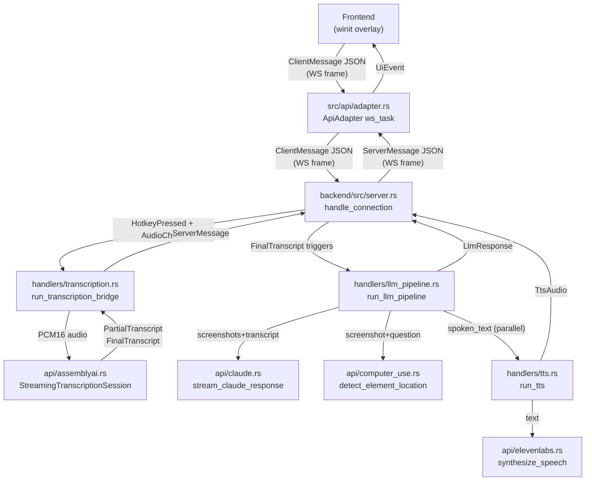

# Backend Architecture

`clicky-backend` is the pipeline server for Clicky Desktop. It owns all external API calls
(AssemblyAI, Anthropic Claude, ElevenLabs) and communicates with the frontend overlay over a
local WebSocket on `ws://127.0.0.1:9001`.

---

## Process Startup

```
main()
  └─ load .env via dotenvy
  └─ init tracing subscriber (LOG_LEVEL env var, default info)
  └─ tokio::main runtime
       └─ server::run(PORT)
            └─ TcpListener::bind("127.0.0.1:9001")
            └─ loop: accept TCP → tokio::spawn(handle_connection)
```

API keys (`ASSEMBLYAI_API_KEY`, `ANTHROPIC_API_KEY`, `ELEVENLABS_API_KEY`, `ELEVENLABS_VOICE_ID`)
are read from environment once per connection inside `handle_connection`. A shared
`reqwest::Client` is constructed once per connection and cloned into spawned tasks.

---

## WebSocket Message Lifecycle

All messages are JSON text frames. Types are defined in `clicky-types` and shared with the
frontend.

### ClientMessage (frontend → backend)

| Variant | Payload | Action |
|---|---|---|
| `HotkeyPressed` | — | Spawns a new `run_transcription_bridge` task |
| `AudioChunk` | `pcm16_bytes: Vec<u8>` | Forwarded to the active transcription session |
| `HotkeyReleased` | — | Signals the transcription bridge to finalize |
| `CancelPipeline` | — | Cancels the active transcription bridge |
| `CursorPosition` | `x, y: f32` | Updates server-side cursor position (used by Computer Use) |
| `Screenshots` | `Vec<ScreenshotData>`, `Vec<DisplayInfo>` | Stored until the next `FinalTranscript` triggers the LLM pipeline |

### ServerMessage (backend → frontend)

| Variant | Payload | When sent |
|---|---|---|
| `PartialTranscript` | `text: String` | Every AssemblyAI streaming turn update |
| `FinalTranscript` | `text: String` | On `Termination` from AssemblyAI (or timeout) |
| `LlmTextDelta` | `text: String` | Each SSE chunk from Claude (not yet consumed by render loop) |
| `LlmResponse` | `spoken_text`, `coordinate`, `display_infos` | End of LLM pipeline |
| `TtsAudio` | `mp3_bytes: Vec<u8>` | ElevenLabs MP3 payload |
| `Error` | `code: ErrorCode`, `message: String` | Any pipeline error |

---

## Connection Handler (`server::handle_connection`)

One `handle_connection` future runs per connected client. It owns:

- A `server_tx / server_rx` mpsc channel — all `ServerMessage` values flow here to reach the WebSocket forwarder task.
- A `pipeline_tx / pipeline_rx` mpsc channel — transcription and LLM tasks produce messages here; `handle_connection` intercepts `FinalTranscript` to trigger the LLM pipeline before forwarding.
- A relay task that copies `relay_tx` → `server_tx` while `handle_connection` handles the select loop.
- `VecDeque<(String, String)> conversation_history` — up to 10 user/assistant turns; `pop_front()` on overflow.
- `Option<ScreenshotData>` — screenshots received via `ClientMessage::Screenshots`, consumed on the next `FinalTranscript`.

WebSocket frames are received and decoded in a `tokio::select!` loop against `pipeline_rx`, allowing the handler to interleave incoming client messages with outgoing pipeline results without additional threads.

The WebSocket is accepted with `accept_async_with_config` enforcing a 32 MiB max message/frame size to prevent oversized payloads from blocking `serde_json::from_str`.

---

## Pipeline Stages



### Stage 1 — Transcription Bridge (`handlers/transcription.rs`)

Spawned per hotkey press. Lifecycle:

1. Fetch AssemblyAI temporary token via shared `reqwest::Client` (reused from `handle_connection`).
2. Open AssemblyAI WebSocket session (`api::assemblyai::StreamingTranscriptionSession::start`).
3. Bridge the blocking `std::sync::mpsc` audio channel into an async channel via `spawn_blocking`.
4. Spawn a transcript relay task that sends `PartialTranscript` / `FinalTranscript` / `Error` messages.
5. Await `cancel_rx` (hotkey released), then drain remaining audio with a **500 ms timeout** to prevent hangs if the audio producer stalls.
6. Send `ForceEndpoint` to AssemblyAI and wait up to **1500 ms** for the final transcript; emit an empty `FinalTranscript` on timeout.

### Stage 2 — LLM Pipeline (`handlers/llm_pipeline.rs`)

Spawned when `FinalTranscript` is non-empty and screenshots are present.

1. Builds a multi-turn conversation message list from `conversation_history`.
2. Calls `api::claude::stream_claude_response` (SSE streaming); individual `LlmTextDelta` messages are not yet forwarded.
3. Parses `[POINT:x,y:label:screenN]` tags via `core::point_parser::parse_claude_response` — a single `captures()` call, no double-regex.
4. **Parallel**: spawns `handlers::tts::run_tts` (ElevenLabs MP3 → `TtsAudio`) if TTS is enabled.
5. Calls `api::computer_use::detect_element_location` for precise coordinate detection on the cursor display.
6. Sends `LlmResponse` with the final coordinate (Computer Use preferred over POINT tags).

### Stage 3 — TTS (`handlers/tts.rs`)

Runs concurrently with Computer Use. Calls `api::elevenlabs::synthesize_speech`, then sends `TtsAudio { mp3_bytes }`. Falls back to `espeak-ng` on error.

---

## Error Handling Chain

All errors are `AppError` (defined in `backend/src/error.rs`), which implements `into_server_message()` to produce a `ServerMessage::Error { code, message }` frame sent to the frontend.

```
AppError variants:
  Config(String)       → ErrorCode::Config
  AssemblyAi(String)   → ErrorCode::Transcription
  Claude(String)       → ErrorCode::LlmApi
  ElevenLabs(String)   → ErrorCode::Tts
  Screenshot(String)   → ErrorCode::Screenshot
```

Error bodies from external APIs are truncated to ≤ 200 chars before being sent to the frontend to avoid leaking full HTTP response bodies.

---

## Logging Configuration

Logging uses `tracing` + `tracing-subscriber` with an env-filter:

```
LOG_LEVEL=debug   # verbose: all API calls, WS frames, audio events
LOG_LEVEL=info    # default: session events, pipeline milestones
LOG_LEVEL=warn    # minimal: only unexpected conditions
LOG_LEVEL=error   # silent in normal operation
```

Set `LOG_LEVEL` in `backend/.env`. The subscriber is initialised in `main()` before any async tasks start.

Debug screenshots (written to the temp directory) are **disabled by default** even in debug builds. Set `CLICKY_DEBUG_SCREENSHOTS=1` in `backend/.env` to enable them.

---

## Key Files

| File | Responsibility |
|---|---|
| `src/main.rs` | Entry point, tracing init, tokio runtime |
| `src/server.rs` | WebSocket listener, connection handler, pipeline orchestration |
| `src/handlers/transcription.rs` | AssemblyAI bridge, audio drain, cancel/finalize |
| `src/handlers/llm_pipeline.rs` | Claude vision, POINT parsing, Computer Use, TTS dispatch |
| `src/handlers/tts.rs` | ElevenLabs TTS, espeak-ng fallback |
| `src/api/assemblyai.rs` | AssemblyAI WebSocket session, turn accumulation |
| `src/api/claude.rs` | Claude SSE streaming client |
| `src/api/computer_use.rs` | Claude Computer Use API, resolution selection, coordinate mapping |
| `src/api/elevenlabs.rs` | ElevenLabs TTS HTTP client |
| `src/core/point_parser.rs` | `[POINT:x,y:label:screenN]` regex parser |
| `src/core/coordinate_mapper.rs` | Screenshot pixels → global display coordinates |
| `src/error.rs` | `AppError` enum + `into_server_message()` |
| `src/logger.rs` | Tracing subscriber setup |
