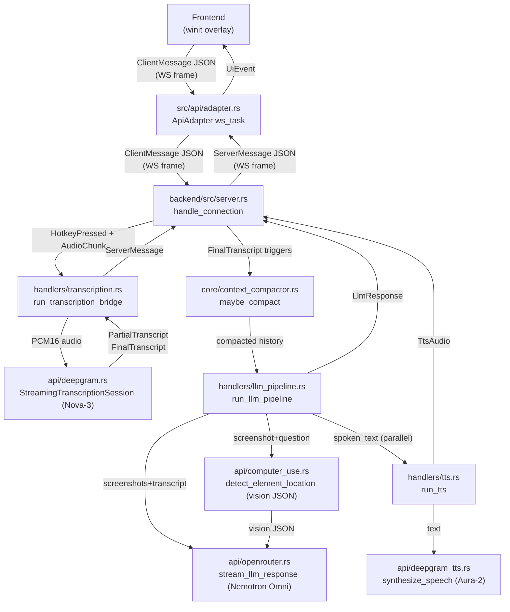

# Backend Architecture

`clicky-backend` is the pipeline server for Clicky Desktop. It owns all external API calls
(Deepgram STT, OpenRouter LLM, Deepgram TTS) and communicates with the frontend overlay over a
local WebSocket on `ws://127.0.0.1:9001`.

---

## Process Startup

```
main()
  └─ load .env via dotenvy
  └─ init tracing subscriber (LOG_LEVEL env var, default info)
  └─ tokio::main runtime
       └─ server::run(PORT)
            └─ TcpListener::bind("127.0.0.1:9001")
            └─ Arc<Semaphore>(20)  ← global OpenRouter RPM cap
            └─ Arc<Semaphore>(45)  ← global Deepgram TTS concurrent cap
            └─ loop: accept TCP → tokio::spawn(handle_connection)
```

API keys (`DEEPGRAM_API_KEY`, `OPENROUTER_API_KEY`) are read from environment once per
connection inside `handle_connection`. A shared `reqwest::Client` is constructed once per
connection and cloned into spawned tasks.

---

## Environment Variables

| Variable | Required | Default | Description |
|---|---|---|---|
| `DEEPGRAM_API_KEY` | Yes | — | Used for both Nova-3 STT and Aura-2 TTS |
| `OPENROUTER_API_KEY` | Yes | — | OpenRouter key for Nemotron Omni (vision + computer use) |
| `DEEPGRAM_TTS_VOICE` | No | `aura-2-thalia-en` | Deepgram Aura-2 voice model |
| `LOG_LEVEL` | No | `info` | `debug` / `info` / `warn` / `error` |
| `PORT` | No | `9001` | WebSocket listen port |

---

## WebSocket Message Lifecycle

All messages are JSON text frames. Types are defined in `clicky-types` and shared with the
frontend.

### ClientMessage (frontend → backend)

| Variant | Payload | Action |
|---|---|---|
| `HotkeyPressed` | — | Spawns a new `run_transcription_bridge` task |
| `AudioChunk` | `pcm16_bytes: Vec<u8>` | Forwarded to the active Deepgram session |
| `HotkeyReleased` | — | Signals the transcription bridge to finalize |
| `CancelPipeline` | — | Cancels the active transcription bridge |
| `CursorPosition` | `x, y: f32` | Updates server-side cursor position |
| `Screenshots` | `Vec<ScreenshotData>`, `Vec<DisplayInfo>` | Stored until the next `FinalTranscript` triggers the LLM pipeline |

### ServerMessage (backend → frontend)

| Variant | Payload | When sent |
|---|---|---|
| `PartialTranscript` | `text: String` | Every Deepgram interim/final result |
| `FinalTranscript` | `text: String` | On WebSocket close after `CloseStream` (or timeout) |
| `LlmResponse` | `spoken_text`, `coordinate`, `display_infos` | End of LLM pipeline |
| `TtsAudio` | `mp3_bytes: Vec<u8>` | Deepgram Aura-2 MP3 payload |
| `Error` | `code: ErrorCode`, `message: String` | Any pipeline error |

---

## Connection Handler (`server::handle_connection`)

One `handle_connection` future runs per connected client. It owns:

- A `server_tx / server_rx` mpsc channel — all `ServerMessage` values flow here to reach the WebSocket forwarder task.
- A `pipeline_tx / pipeline_rx` mpsc channel — transcription and LLM tasks produce messages here; `handle_connection` intercepts `FinalTranscript` to trigger the LLM pipeline before forwarding.
- A relay task that copies `relay_tx` → `server_tx` while `handle_connection` handles the select loop.
- `VecDeque<(String, String)> conversation_history` — up to 10 user/assistant turns; `pop_front()` on overflow. Context compaction fires at 80% of 256K tokens before each LLM call.
- `Option<(Vec<ScreenshotData>, Vec<DisplayInfo>)>` — screenshots received via `ClientMessage::Screenshots`, consumed on the next `FinalTranscript`.

---

## Pipeline Stages



### Stage 1 — Transcription Bridge (`handlers/transcription.rs`)

Spawned per hotkey press. Lifecycle:

1. Open Deepgram Nova-3 WebSocket session (`api::deepgram::StreamingTranscriptionSession::start`). No separate token fetch — auth is via `Authorization: Token <key>` header on the WS URL.
2. Bridge the blocking `std::sync::mpsc` audio channel into an async channel via `spawn_blocking`.
3. Spawn a transcript relay task that sends `PartialTranscript` / `FinalTranscript` / `Error` messages.
4. Await `cancel_rx` (hotkey released), then drain remaining audio with a **500 ms timeout** to prevent hangs if the audio producer stalls.
5. Send `{"type":"CloseStream"}` to Deepgram and wait up to **1500 ms** for the final transcript; emit an empty `FinalTranscript` on timeout.

### Stage 1.5 — Context Compaction (`core/context_compactor.rs`)

Called synchronously (awaited) in `server.rs` before triggering the LLM pipeline, so the history passed to `run_llm_pipeline` is always within token budget.

- Token estimate: `text.len() / 4` (chars-to-tokens heuristic).
- Threshold: 80% of Nemotron's 256K context window (~205K tokens).
- When triggered: last 2 exchanges are preserved verbatim; older exchanges are summarised into a single synthetic exchange via a non-streaming LLM call (consumes one OpenRouter permit).

### Stage 2 — LLM Pipeline (`handlers/llm_pipeline.rs`)

Spawned when `FinalTranscript` is non-empty and screenshots are present.

1. Builds a multi-turn conversation message list from `conversation_history`.
2. Calls `api::openrouter::stream_llm_response` (OpenAI-compat SSE, Nemotron Omni). Acquires one permit from the global 20-permit semaphore before each request; 429 responses trigger exponential backoff (1 s → 2 s → 4 s, max 3 retries).
3. Parses `[POINT:x,y:label:screenN]` tags via `core::point_parser::parse_claude_response`.
4. **Parallel**: spawns `handlers::tts::run_tts` (Deepgram Aura-2 MP3 → `TtsAudio`) if TTS is enabled.
5. Calls `api::computer_use::detect_element_location` for precise coordinate detection on the cursor display. Sends a structured JSON prompt to Nemotron Omni; parses the `{"x": int, "y": int, "label": str}` response (strips markdown fences). Acquires one OpenRouter permit.
6. Sends `LlmResponse` with the final coordinate (Computer Use preferred over POINT tags).

### Stage 3 — TTS (`handlers/tts.rs`)

Runs concurrently with Computer Use. Calls `api::deepgram_tts::synthesize_speech`, then sends `TtsAudio { mp3_bytes }`. Falls back to `espeak-ng` on error (handled by the frontend).

---

## Rate-Limit Semaphores

| Semaphore | Permits | Cap source | Used by |
|---|---|---|---|
| `llm_rate_limiter` | 20 | OpenRouter 20 RPM (funded account) | `openrouter::stream_llm_response`, `computer_use::detect_element_location`, `context_compactor::summarise_exchanges` |
| `tts_rate_limiter` | 45 | Deepgram 45 concurrent streams | Reserved; currently not passed to `run_tts` (Deepgram 225 STT sessions >> 50 users, so only TTS needs tracking) |

---

## Error Handling Chain

All errors are `AppError` (defined in `backend/src/error.rs`), which implements `into_server_message()` to produce a `ServerMessage::Error { code, message }` frame sent to the frontend.

```
AppError variants:
  Config(String)        → ErrorCode::Internal
  Transcription(String) → ErrorCode::Transcription
  Llm(String)           → ErrorCode::LlmPipeline
  Tts(String)           → ErrorCode::Tts
  ComputerUse(String)   → ErrorCode::ComputerUse
  Screenshot(String)    → ErrorCode::Screenshot
```

---

## Logging Configuration

Logging uses `tracing` + `tracing-subscriber` with an env-filter:

```
LOG_LEVEL=debug   # verbose: all API calls, WS frames, audio events
LOG_LEVEL=info    # default: session events, pipeline milestones
LOG_LEVEL=warn    # minimal: only unexpected conditions
LOG_LEVEL=error   # silent in normal operation
```

Set `LOG_LEVEL` in `backend/.env`. The subscriber is initialised in `main()` before any async tasks start.

Debug screenshots (written to the temp directory) are **disabled by default** even in debug builds. Set `CLICKY_DEBUG_SCREENSHOTS=1` in `backend/.env` to enable them.

---

## Key Files

| File | Responsibility |
|---|---|
| `src/main.rs` | Entry point, tracing init, tokio runtime |
| `src/server.rs` | WebSocket listener, connection handler, global semaphores, pipeline orchestration |
| `src/handlers/transcription.rs` | Deepgram bridge, audio drain, cancel/finalize |
| `src/handlers/llm_pipeline.rs` | OpenRouter vision, POINT parsing, Computer Use, TTS dispatch |
| `src/handlers/tts.rs` | Deepgram Aura-2 TTS, espeak-ng fallback |
| `src/api/deepgram.rs` | Deepgram Nova-3 WebSocket session, interim/final transcript accumulation |
| `src/api/openrouter.rs` | OpenRouter SSE streaming client, rate-limit retries |
| `src/api/computer_use.rs` | Vision-based JSON coordinate detection via Nemotron Omni |
| `src/api/deepgram_tts.rs` | Deepgram Aura-2 TTS HTTP client |
| `src/core/context_compactor.rs` | Token estimation, history summarisation at 80% of 256K |
| `src/core/point_parser.rs` | `[POINT:x,y:label:screenN]` regex parser |
| `src/core/coordinate_mapper.rs` | Screenshot pixels → global display coordinates |
| `src/error.rs` | `AppError` enum + `into_server_message()` |
| `src/logger.rs` | Tracing subscriber setup |
